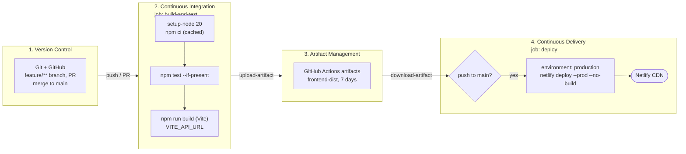
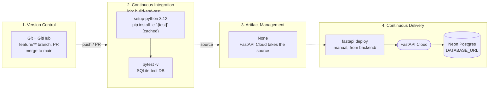

# CI/CD pipeline

How code gets from a developer's machine to production. The frontend and backend each have their own
pipeline, and both follow the same four stages: Version Control, Continuous Integration, Artifact
Management and Continuous Delivery. The diagrams are Mermaid, which GitHub renders in the browser.

Solid arrows are automated. Dashed arrows are manual steps (see [devops-checklist.md](./devops-checklist.md)).

## Frontend pipeline

Workflow: [frontend-ci.yml](../.github/workflows/frontend-ci.yml). Runs only when `frontend/**` changes.

| Stage | Tools | What happens |
|---|---|---|
| 1. Version Control | Git, GitHub | Work on a `feature/**` branch, open a PR, review, merge to `main` |
| 2. Continuous Integration | GitHub Actions, Node 20, npm, Vite | Install from the lockfile, run tests if a `test` script exists, build with `VITE_API_URL` baked in |
| 3. Artifact Management | GitHub Actions artifacts | `frontend/dist` is stored as `frontend-dist` for 7 days, and the deploy job uses that same build |
| 4. Continuous Delivery | Netlify CLI, Netlify | On a push to `main`, deploy to production using `NETLIFY_AUTH_TOKEN` and `NETLIFY_SITE_ID`. PRs and feature branches stop after CI |

## Backend pipeline

Workflow: [backend-ci.yml](../.github/workflows/backend-ci.yml). Runs only when `backend/**` changes.

| Stage | Tools | What happens |
|---|---|---|
| 1. Version Control | Git, GitHub | Same flow as the frontend |
| 2. Continuous Integration | GitHub Actions, Python 3.12, pip, pytest | Install with the `test` extra, run the test suite against SQLite |
| 3. Artifact Management | none | There is no build output. FastAPI Cloud builds from the source in `backend/` |
| 4. Continuous Delivery | FastAPI Cloud CLI, FastAPI Cloud, Neon | A person runs `fastapi deploy`. The running app reads `DATABASE_URL` and `CORS_ORIGINS` from FastAPI Cloud settings and connects to Neon |

## Gaps

**Frontend**
- No lint step, and no tests yet.
- No preview deploys for PRs, and no check after deploy that the site loads.

**Backend**
- No automated deploy, so a person runs the command.
- No migration step. The app creates tables on startup, and tests run on SQLite while production runs Postgres.
- No check after deploy that `/health` responds.

**Across both**
- Nothing orders the two deploys. If an API change and a frontend change merge together, the frontend can
  go live before the backend is ready.
