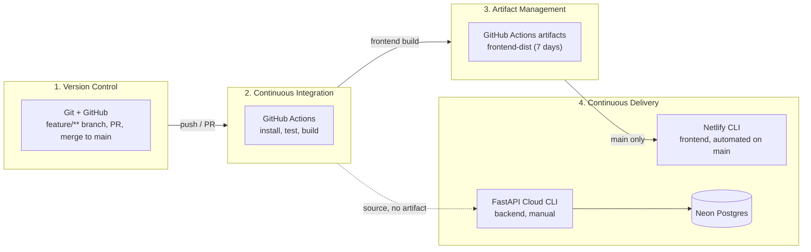
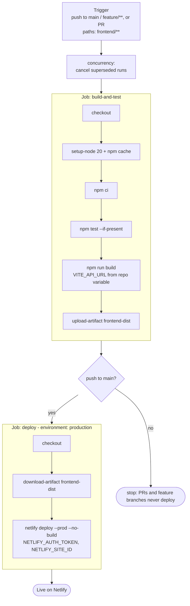
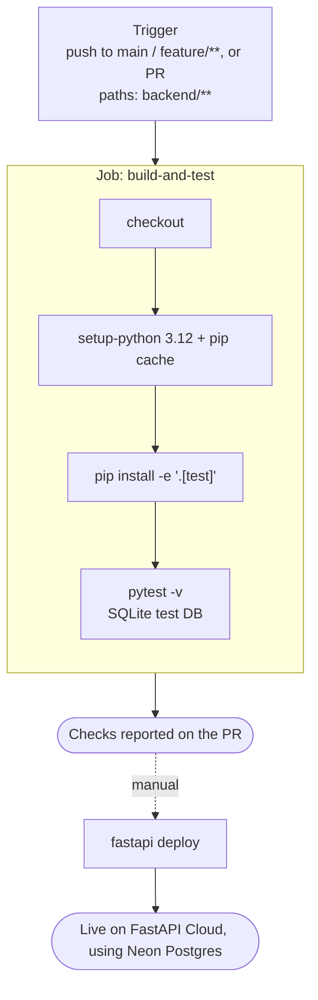

# CI/CD pipeline

How code gets from a developer's machine to production, and which tool does each stage.
The diagrams are Mermaid, which GitHub renders in the browser.

## General pipeline

Four stages: Version Control, Continuous Integration, Artifact Management, Continuous Delivery.

Solid arrows are automated. Dashed arrows are manual steps (see [devops-checklist.md](./devops-checklist.md)).

## Stages and tools

| Stage | Tools | What happens |
|---|---|---|
| 1. Version Control | Git, GitHub | Work on a `feature/**` branch, open a PR, review, merge to `main` |
| 2. Continuous Integration | GitHub Actions | Backend: Python 3.12, `pip install`, `pytest`. Frontend: Node 20, `npm ci`, `npm test`, `npm run build`. Each runs only when its folder changes |
| 3. Artifact Management | GitHub Actions artifacts | The frontend build (`frontend/dist`) is stored as `frontend-dist` for 7 days. The backend has no artifact, since FastAPI Cloud takes the source |
| 4. Continuous Delivery | Netlify CLI, FastAPI Cloud CLI, Neon | Frontend deploys from `main` through the `production` environment. Backend deploys by hand with `fastapi deploy`. The backend reads `DATABASE_URL` from Neon |

## Frontend workflow in detail

## Backend workflow in detail

## Gaps this diagram shows

- The backend has no automated deploy, so the dashed arrow is a person running a command.
- Nothing orders the two deploys. If an API change and a frontend change merge together, the frontend can
  go live before the backend is ready.
- There is no step after deploy that checks the site is up.
- There is no migration step. The app creates tables on startup.
