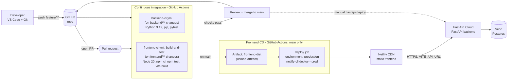

# CI/CD pipeline

How code gets from a developer's machine to production, and which tool does each stage.
The diagrams are Mermaid, which GitHub renders in the browser.

Solid arrows are automated. Dashed arrows are manual steps that are not automated yet (see
[devops-checklist.md](./devops-checklist.md)).

## End-to-end flow

## Stages and tools

| Stage | Trigger | Tool | What happens |
|---|---|---|---|
| Code | local | Git, VS Code | Work on a `feature/**` branch |
| Source | push, PR | GitHub | Hosts the repo and runs the checks |
| Backend CI | `backend/**` change on push or PR | GitHub Actions | Set up Python 3.12, `pip install -e ".[test]"`, `pytest` |
| Frontend CI | `frontend/**` change on push or PR | GitHub Actions | Set up Node 20, `npm ci`, `npm test --if-present`, `npm run build` |
| Package | after frontend build | GitHub Actions artifacts | `frontend/dist` is stored as `frontend-dist` for 7 days |
| Frontend CD | push to `main`, CI green | GitHub Actions + Netlify CLI | The `production` environment job downloads the artifact and deploys it |
| Frontend host | after deploy | Netlify | Serves the static files from its CDN |
| Backend CD | manual | FastAPI Cloud CLI | `fastapi deploy` from `backend/` |
| Backend host | after deploy | FastAPI Cloud | Runs the API, with `DATABASE_URL` and `CORS_ORIGINS` set in its settings |
| Database | runtime | Neon | Serverless Postgres, reached through the pooled connection string |

## Frontend workflow in detail

## Backend workflow in detail

## Gaps this diagram shows

- The backend has no automated deploy, so the dashed arrow is a person running a command.
- Nothing orders the two deploys. If an API change and a frontend change merge together, the frontend can
  go live before the backend is ready.
- There is no step after deploy that checks the site is up.
- There is no migration step. The app creates tables on startup.
